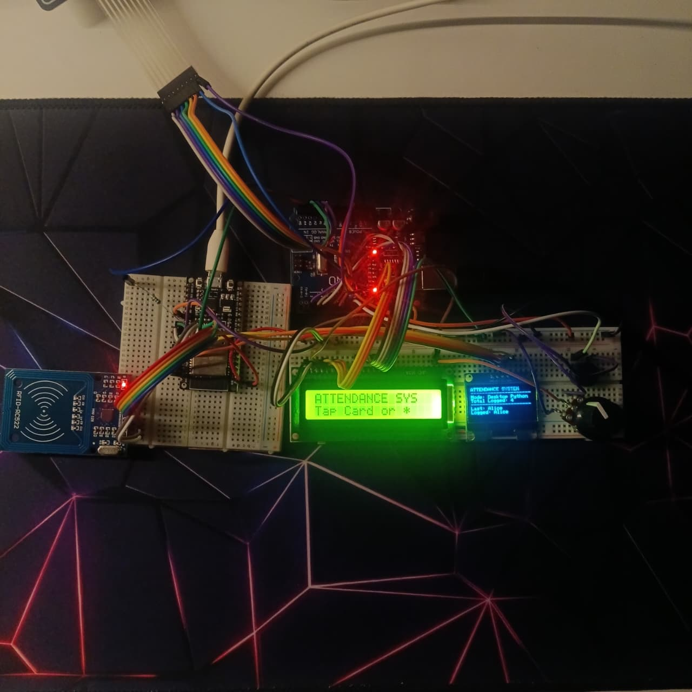

# 🔌 Ultimate Master Hardware Connection & Wiring Manual
### Project: IoT Dual-Factor Smart Attendance Tracking System
*Document Version: 2.0 (Verified & Confirmed Hardware Build)*

---

<p align="center">
  
</p>

---

## 📑 Table of Contents
1. [Component Identification & Pin Numbering](#1-component-identification--pin-numbering)
2. [Critical Electrical Safety & Voltage Rules](#2-critical-electrical-safety--voltage-rules)
3. [Master Wire-by-Wire Connection Tables](#3-master-wire-by-wire-connection-tables)
   * [A. 16x2 Parallel LCD & Contrast Circuit](#a-16x2-parallel-lcd--contrast-circuit)
   * [B. 10kΩ Potentiometer Wiring](#b-10kω-potentiometer-wiring)
   * [C. 4x4 Matrix Keypad (8 Pins)](#c-4x4-matrix-keypad-8-pins)
   * [D. Active Buzzer](#d-active-buzzer)
   * [E. RC522 RFID Reader (SPI Bus)](#e-rc522-rfid-reader-spi-bus)
   * [F. SH110X / SSD1306 OLED Display (I2C)](#f-sh110x--ssd1306-oled-display-i2c)
   * [G. Inter-Board Serial Bridge (Uno ⇄ ESP32)](#g-inter-board-serial-bridge-uno--esp32)
4. [Breadboard Power Distribution & Split-Rail Fix](#4-breadboard-power-distribution--split-rail-fix)
5. [Visual ASCII Circuit Schematic Map](#5-visual-ascii-circuit-schematic-map)
6. [Pre-Power Checklist (7-Point Safety Check)](#6-pre-power-checklist-7-point-safety-check)

---

## 1. Component Identification & Pin Numbering

### 1.1 16x2 Parallel Character LCD (HD44780)
* **Pin 1 vs Pin 16:** Looking at the **front** of the LCD screen (with the pins running along the top edge):
  * **Pin 1** is on the **FAR LEFT**, labeled `1` or `VSS`.
  * **Pin 16** is on the **FAR RIGHT**, labeled `16` or `K`.
* **Header Pins:** Ensure the 16-pin male header is **soldered firmly** to the green PCB holes. Loose/friction-fit pins will cause data bus corruption (`████████` blocks or `?___?` symbols).

### 1.2 10kΩ Contrast Potentiometer
* A standard breadboard trimpot has **3 legs**:
  * **Left Leg (Terminal 1):** Connects to **5V**.
  * **Center Leg (Terminal 2 - Wiper):** Connects to **LCD Pin 3 (V0)**.
  * **Right Leg (Terminal 3):** Connects to **GND**.
  *(Swapping Left and Right outer legs only changes rotation direction — both work identically).*

### 1.3 4x4 Matrix Keypad (16 Keys: 0–9, A–D, *, #)
* Hold the keypad facing you with the ribbon cable hanging downwards.
* Count the **8 pin holes from Left to Right (Pins 1 through 8)**:
  * **Pins 1, 2, 3, 4** = **Rows 1, 2, 3, 4** (Inputs)
  * **Pins 5, 6, 7, 8** = **Columns 1, 2, 3, 4** (Outputs)

### 1.4 RC522 RFID Reader Module
* Inspect the silkscreen printing on the blue PCB:
  * Pins: `SDA` | `SCK` | `MOSI` | `MISO` | `IRQ` | `GND` | `RST` | `3.3V`

### 1.5 Active Buzzer
* **Positive (+):** Longer leg (or marked with a `+` sticker on top).
* **Negative (-):** Shorter leg.

---

## 2. Critical Electrical Safety & Voltage Rules

> [!CAUTION]
> **1. NEVER CONNECT 5V TO THE RC522 RFID VCC!**
> The RC522 reader chip operates strictly on **3.3V**. Connecting 5V will instantly fry the RF transceiver coil and silicon.
>
> **2. VOLTAGE STEP-DOWN (UNO ➔ ESP32):**
> Arduino Uno outputs 5V on its digital pins. The ESP32 GPIOs are **3.3V logic tolerant only**. 
> You **MUST** place a **1kΩ resistor in series** between Arduino **Pin A5 (TX)** and ESP32 **GPIO 16 (RX2)** to limit current to $<1.4\text{mA}$ and protect the ESP32 input stage.
>
> **3. MANDATORY COMMON GROUND:**
> Both Arduino Uno and ESP32 must have a direct, solid jumper wire connecting their **GND** pins together. Without common ground, serial signals have no voltage reference and communication will fail completely.

---

## 3. Master Wire-by-Wire Connection Tables

### A. 16x2 Parallel LCD & Contrast Circuit

| LCD Pin # | Label on LCD | Connect To | Wire Color Suggestion | Purpose / Details |
|:---:|:---:|:---|:---:|:---|
| **Pin 1** | **VSS** | **Arduino GND** | Black | Ground reference |
| **Pin 2** | **VDD** | **Arduino 5V** | Red | +5V Logic Power |
| **Pin 3** | **V0** | **Potentiometer Center Leg** | Yellow | Analog Contrast Voltage ($0\text{V} - 0.8\text{V}$) |
| **Pin 4** | **RS** | **Arduino Digital Pin 12** | Orange | Register Select (LOW=Command, HIGH=Data) |
| **Pin 5** | **RW** | **Arduino GND** | Black | **MUST BE GND** (Forces LCD into Write Mode) |
| **Pin 6** | **E** | **Arduino Digital Pin 11** | White | Enable Latch Clock (Falling-edge triggered) |
| **Pin 7** | **D0** | *LEAVE DISCONNECTED* | — | Not used in 4-bit nibble mode |
| **Pin 8** | **D1** | *LEAVE DISCONNECTED* | — | Not used in 4-bit nibble mode |
| **Pin 9** | **D2** | *LEAVE DISCONNECTED* | — | Not used in 4-bit nibble mode |
| **Pin 10** | **D3** | *LEAVE DISCONNECTED* | — | Not used in 4-bit nibble mode |
| **Pin 11** | **D4** | **Arduino Digital Pin 5** | Blue | Data bit 4 |
| **Pin 12** | **D5** | **Arduino Digital Pin 4** | Green | Data bit 5 |
| **Pin 13** | **D6** | **Arduino Digital Pin 3** | Purple | Data bit 6 |
| **Pin 14** | **D7** | **Arduino Digital Pin 2** | Gray | Data bit 7 (Most Significant Bit) |
| **Pin 15** | **A (LED+)** | **Arduino 5V** | Red | Backlight LED Anode (+) |
| **Pin 16** | **K (LED-)** | **Arduino GND** | Black | Backlight LED Cathode (-) |

---

### B. 10kΩ Potentiometer Wiring

| Potentiometer Terminal | Connect To | Notes |
|:---|:---|:---|
| **Terminal 1 (Left Leg)** | **Arduino 5V** | Upper voltage rail |
| **Terminal 2 (Center Wiper Leg)** | **LCD Pin 3 (V0)** | Adjusts contrast voltage |
| **Terminal 3 (Right Leg)** | **Arduino GND** | Lower voltage rail |

> **Pro-Tip on Contrast Tuning:** Once powered, turn the knob until the solid blue/green blocks fade into crisp, dark letters. If you do not have a potentiometer, connect **LCD Pin 3 directly to GND** with a jumper wire for 100% contrast.

---

### C. 4x4 Matrix Keypad (8 Pins)

| Ribbon Pin # (Left-to-Right) | Keypad Matrix Line | Connect To Arduino Pin | Code Mapping |
|:---:|:---:|:---:|:---|
| **Pin 1** | **Row 1** (Keys: 1, 2, 3, A) | **Arduino Pin A0** | `rowPins[0]` |
| **Pin 2** | **Row 2** (Keys: 4, 5, 6, B) | **Arduino Pin A1** | `rowPins[1]` |
| **Pin 3** | **Row 3** (Keys: 7, 8, 9, C) | **Arduino Pin A2** | `rowPins[2]` |
| **Pin 4** | **Row 4** (Keys: *, 0, #, D) | **Arduino Pin A3** | `rowPins[3]` |
| **Pin 5** | **Column 1** (Keys: 1, 4, 7, *) | **Arduino Digital Pin 6** | `colPins[0]` |
| **Pin 6** | **Column 2** (Keys: 2, 5, 8, 0) | **Arduino Digital Pin 7** | `colPins[1]` |
| **Pin 7** | **Column 3** (Keys: 3, 6, 9, #) | **Arduino Digital Pin 8** | `colPins[2]` |
| **Pin 8** | **Column 4** (Keys: A, B, C, D) | **Arduino Digital Pin 10** | `colPins[3]` |

---

### D. Active Buzzer

| Buzzer Terminal | Connect To | Notes |
|:---|:---|:---|
| **Long Leg (+)** | **Arduino Digital Pin 9** | Driven by `tone()` function |
| **Short Leg (-)** | **Arduino GND** | Ground |

---

### E. RC522 RFID Reader (SPI Bus)

| RC522 Pin Label | Connect To ESP32 GPIO | Bus Function | Voltage & Signal Notes |
|:---:|:---:|:---:|:---|
| **3.3V (VCC)** | **ESP32 3.3V Pin** | Power | **MUST BE 3.3V ONLY** |
| **RST** | **ESP32 GPIO 4** | Reset | Active-low hardware reset |
| **GND** | **ESP32 GND Pin** | Ground | Ground |
| **IRQ** | *LEAVE DISCONNECTED* | Interrupt | Not needed (software polling) |
| **MISO** | **ESP32 GPIO 19** | SPI MISO | Master In, Slave Out |
| **MOSI** | **ESP32 GPIO 23** | SPI MOSI | Master Out, Slave In |
| **SCK** | **ESP32 GPIO 18** | SPI SCK | Serial Clock |
| **SDA (SS)** | **ESP32 GPIO 5** | SPI CS | Slave Select (Chip Select) |

---

### F. SH110X / SSD1306 OLED Display (I2C Bus)

| OLED Pin Label | Connect To ESP32 GPIO | Bus Function |
|:---:|:---:|:---|
| **GND** | **ESP32 GND** | Ground |
| **VCC** | **ESP32 3.3V** *(or VIN)* | 3.3V / 5V Power |
| **SCL** | **ESP32 GPIO 22** | I2C Clock line |
| **SDA** | **ESP32 GPIO 21** | I2C Data line |

---

### G. Inter-Board Serial Bridge (Uno ⇄ ESP32)

Connect the two microcontrollers using **3 wires** and **one 1kΩ resistor**:

```text
[Arduino Uno R3]                                     [ESP32 DevKit]
      GND       ──────────────── DIRECT WIRE ──────────────   GND   (Common Reference)

   Pin A5 (TX)  ──[ 1kΩ Resistor in Series ]──►  GPIO 16 (RX2) (Safe 3.3V input)

   Pin A4 (RX)  ◄─────────────── DIRECT WIRE ──────────────  GPIO 17 (TX2) (3.3V HIGH logic)
```

| From Arduino Uno | Connection Method | To ESP32 | Purpose |
|:---|:---|:---|:---|
| **GND** | Direct Jumper Wire | **GND** | Establishes identical ground reference |
| **Pin A5 (SoftwareSerial TX)** | **Through 1kΩ Resistor in series** | **GPIO 16 (Hardware RXD2)** | Uno 5V output current limited to protect ESP32 |
| **Pin A4 (SoftwareSerial RX)** | Direct Jumper Wire | **GPIO 17 (Hardware TXD2)** | ESP32 3.3V output safely read as HIGH by ATmega328P |

---

## 4. Breadboard Power Distribution & Split-Rail Fix

### The Common Breadboard Trap:
Full-size breadboards (830 tie-points) have their power rails **split in half at column 30**:
```text
[TOP LEFT + RAIL]  ---[GAP]---  [TOP RIGHT + RAIL]
[TOP LEFT - RAIL]  ---[GAP]---  [TOP RIGHT - RAIL]
```
If your Arduino 5V/GND wires are plugged into the **left half**, but your LCD is plugged into the **right half**, the LCD gets **0 volts**.

### How to Bridge the Rails:
1. Connect a short red jumper from `Top Left (+)` to `Top Right (+)`.
2. Connect a short black jumper from `Top Left (-)` to `Top Right (-)`.
3. Connect a short black jumper from `Top Left (-)` to `Bottom Left (-)`.

---

## 5. Visual ASCII Circuit Schematic Map

```text
               +---------------------------------------------------+
               |                  ARDUINO UNO R3                   |
               |                                                   |
               |  5V   GND   A0   A1   A2   A3   A4   A5           |
               +---|----|-----|----|----|----|----|----|-----------+
                   |    |     |    |    |    |    |    |
                   |    |     |    |    |    |    |    +--[ 1kΩ Resistor ]--+
                   |    |     |    |    |    |    |                         |
                   |    |     +----+----+----+    |                         |
                   |    |          |              |                         |
                   |    |      [KEYPAD: Rows]     |                         |
                   |    |      (Pins 1 to 4)      |                         |
                   |    |                         |                         |
                   |    |   +---------------------+                         |
                   |    |   |                                               |
               +---|----|---|---|---|---|---|---|---|--------------+        |
               |  GND  3.3V |  GPIO |  GPIO |  GPIO |              |        |
               |            |   17  |   16  |   5   |  18  19  23  |        |
               |            |  (TX) |  (RX) |  (SS) | (SCK)(MISO)(MOSI)    |
               |            |       |   ^   |   |       |   |   |  |        |
               |            |       |   |   |   |       |   |   |  |        |
               |            |       |   +---|---|-------+   |   |  |        |
               |            |       |       |   |           |   |  |        |
               |            |       +-------+   |           |   |  |        |
               |            |                   |           |   |  |        |
               |            |     ESP32 DEVKIT  |           |   |  |        |
               +------------|-------------------|-----------|---|--+        |
                            |                   |           |   |           |
                            |                   +-----+     |   |           |
                            |                         |     |   |           |
                            |                   +-----v-----v---v-----+     |
                            |                   |     RC522 RFID      |     |
                            |                   | (VCC to ESP32 3.3V!)|     |
                            |                   +---------------------+     |
                            |                                               |
             +--------------+                                               |
             |                                                              |
   +---------v--------------------------------------------------------------v-------+
   | LCD 16x2 Parallel:                                                             |
   | Pin 1(VSS)=GND | Pin 2(VDD)=5V | Pin 3(V0)=Pot Wiper | Pin 4(RS)=Uno 12        |
   | Pin 5(RW)=GND  | Pin 6(E)=Uno 11 | Pins 11-14(D4-D7)=Uno 5, 4, 3, 2            |
   | Pin 15(A)=5V   | Pin 16(K)=GND                                                 |
   +--------------------------------------------------------------------------------+
```

---

## 6. Pre-Power Checklist (7-Point Safety Check)

Before plugging USB cables into your laptop, verify these 7 points:

* [ ] **1. RFID Power:** Is the RC522 VCC wire plugged into **ESP32 3.3V** and **NOT 5V**?
* [ ] **2. Resistor Protection:** Is the **1kΩ resistor** placed in series between Uno A5 and ESP32 GPIO 16?
* [ ] **3. Common Ground:** Is there a solid direct wire connecting **Uno GND to ESP32 GND**?
* [ ] **4. LCD Pin 5 (RW):** Is LCD Pin 5 plugged firmly into **GND**? *(If loose, screen locks on black blocks).*
* [ ] **5. LCD Pin 3 (V0):** Is Pin 3 connected to the potentiometer wiper or GND?
* [ ] **6. LCD Data Bus:** Are data lines D4, D5, D6, D7 connected to Uno pins **5, 4, 3, 2** respectively?
* [ ] **7. Breadboard Rails:** If using both halves of the breadboard, are the center rail gaps bridged?
