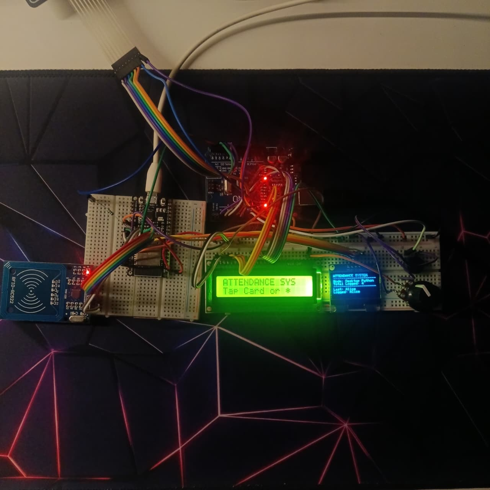

# 🎓 IoT Dual-Factor Smart Attendance Tracking System

An end-to-end, edge-computing embedded attendance tracking system built with **Arduino Uno**, **ESP32**, **RC522 RFID**, **16x2 Parallel LCD**, **4x4 Matrix Keypad**, **Active Buzzer**, and a modern **Python Desktop GUI Dashboard**.

---

<p align="center">
  
</p>

---

## 🌟 Key Features

1. **Dual-Factor Authentication:**
   * **Primary:** Contactless 13.56MHz Mifare RFID card/fob tap.
   * **Secondary / Fallback:** Manual Roll Number entry + 4-digit PIN verification on a 4x4 matrix keypad.
2. **Dual-Microcontroller Distributed Architecture:**
   * **Arduino Uno (ATmega328P):** Manages user-facing physical I/O (16x2 Parallel LCD, 4x4 Keypad matrix, Buzzer chimes, and SoftwareSerial bridge).
   * **ESP32 DevKit (Dual-Core 240MHz):** Handles high-frequency SPI communication with the RC522 RFID reader, student database matching, OLED telemetry, and streaming JSON packets to the PC.
3. **No Cloud Dependency (100% Offline Edge Computing):**
   * Operates completely offline without external internet, preventing network latency or downtime.
4. **Python Desktop GUI Dashboard:**
   * Modern dark-themed application built using `customtkinter`.
   * Real-time attendance log table (`#`, Timestamp, Roll Number, Student Name, Method, Status).
   * Live statistics cards (Total Attendees Present, Last Verified Student, Connection status).
   * One-click **Export to CSV** for spreadsheets/records.
   * Hardware simulation triggers for testing John (`F30` / `101`) and Alice (`DF5` / `102`).

---

## 📁 Repository & Folder Structure

```text
ROBOTICS PROJECTS/
└── IoT_Dual_Factor_Attendance_System/
    ├── README.md                              <- Master Project Guide
    ├── Arduino_Uno_Firmware/
    │   └── Attendance_Uno.ino                 <- Arduino Uno firmware (LCD, Keypad, Buzzer)
    ├── ESP32_Firmware/
    │   └── Attendance_ESP32.ino               <- ESP32 firmware (RFID, OLED, Serial Bridge)
    ├── Desktop_App/
    │   ├── attendance_app.py                  <- Python CustomTkinter Dashboard
    │   └── Launch_Attendance_App.bat          <- One-click Windows Launcher
    └── Documentation/
        ├── CIRCUIT_CONNECTIONS.md             <- Exact wire-by-wire connection tables
        ├── SYSTEM_ARCHITECTURE.md             <- Block diagrams & communication protocols
        ├── TROUBLESHOOTING_GUIDE.md           <- Contrast, 4-bit bus sync, & clone chip fixes
        └── PROJECT_SCRIPTS.md                 <- 10-15s demonstration scripts for reels/demos
```

---

## 🛠️ Bill of Materials (Components Used)

| Component | Quantity | Purpose |
|---|:---:|---|
| **Arduino Uno R3** | 1 | Controls LCD, Keypad, Buzzer, and state machine |
| **ESP32 DevKit V1** | 1 | Reads RC522 RFID reader, verifies PINs, streams to PC |
| **RC522 RFID Reader + Cards** | 1 | 13.56MHz contactless ID card detection |
| **16x2 Parallel Character LCD** | 1 | Displays system status, welcome prompts, and PIN input |
| **10kΩ Potentiometer** | 1 | Controls LCD contrast (Pin 3 - V0) |
| **4x4 Matrix Keypad** | 1 | 16-key keypad for manual Roll & PIN entry |
| **Active/Passive Buzzer** | 1 | Audio confirmation chirps, error tones, and key beeps |
| **SH110X / SSD1306 OLED** | 1 | Secondary 128x64 display on ESP32 (I2C) |
| **1kΩ Resistor** | 1 | Voltage level protection between Uno TX (5V) and ESP32 RX (3.3V) |
| **Full-Size Breadboard & Jumpers** | 1 | Circuit prototyping |

---

## ⚡ Quick Start Instructions

1. **Hardware Setup:** Follow the wire-by-wire pinouts in [`Documentation/CIRCUIT_CONNECTIONS.md`](Documentation/CIRCUIT_CONNECTIONS.md).
2. **Flash Arduino Uno:** Open `Arduino_Uno_Firmware/Attendance_Uno.ino` in Arduino IDE and flash to your Uno port (`COM12`).
3. **Flash ESP32:** Open `ESP32_Firmware/Attendance_ESP32.ino` in Arduino IDE and flash to your ESP32 port (`COM8`).
4. **Launch Desktop App:** Double-click `Desktop_App/Launch_Attendance_App.bat` or run:
   ```powershell
   py -3.11 attendance_app.py
   ```
5. **Verify:**
   * Tap card `F30` ➔ Welcome John (Roll 101).
   * Tap card `DF5` ➔ Welcome Alice (Roll 102).
   * Press `*` on keypad ➔ Enter Roll `101` + `#`, then PIN `1234` + `#`.
